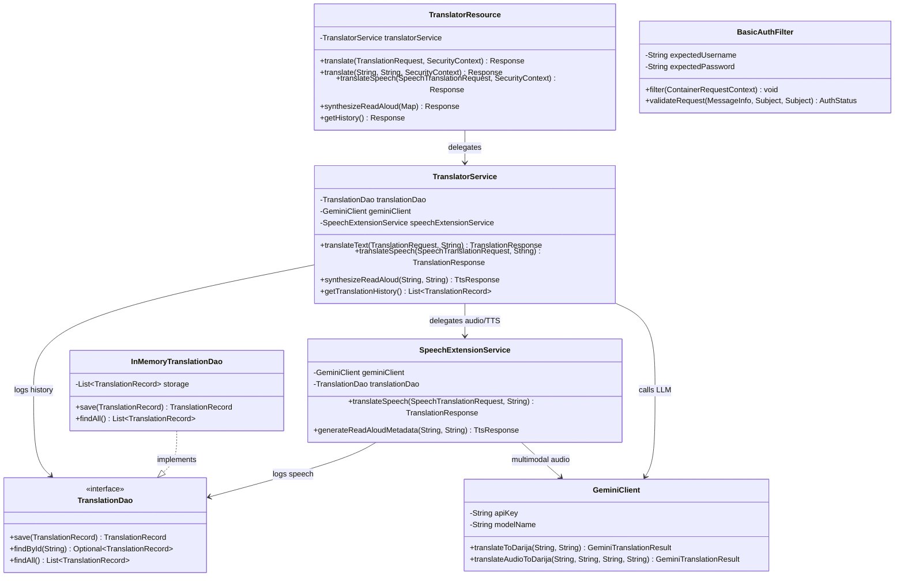
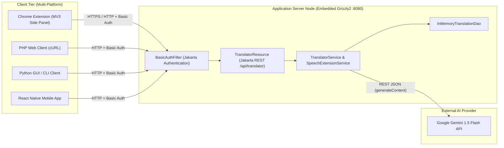

# Mini Project 2: LLM-Powered Moroccan Darija RESTful Web Service

A complete, production-ready 3-tier translation system that translates English (and other source languages) into the **Moroccan Arabic Dialect (Darija)** using **Google Gemini (`gemini-1.5-flash`)**, exposed via **Jakarta RESTful Web Services (JAX-RS 3.1)** and secured with **Jakarta Authentication Specification (HTTP Basic Auth)**.

---

## 1. Directory Structure

```text
TranslationApp/
├── README.md
├── backend/                                        # Task 1: Maven Jakarta RESTful Web Service
│   ├── pom.xml
│   └── src/main/java/com/darija/translator/
│       ├── ServerMain.java                         # Embedded Grizzly2 HTTP Container Launcher
│       ├── presentation/                           # Tier 1: Presentation Layer (JAX-RS + Security)
│       │   ├── TranslatorResource.java             # REST Endpoint with translate(), translateSpeech(), synthesizeReadAloud()
│       │   ├── BasicAuthFilter.java                # Jakarta Authentication (ServerAuthModule + ContainerRequestFilter)
│       │   └── CorsFilter.java                     # Cross-Origin Resource Sharing Filter
│       ├── logic/                                  # Tier 2: Business Logic & LLM Integration Layer
│       │   ├── TranslatorService.java              # Core translation orchestration service
│       │   ├── GeminiClient.java                   # Google Gemini 1.5 Flash REST API client + offline fallback
│       │   └── SpeechExtensionService.java         # Task 3: Voice-to-Voice & Read-Aloud (TTS/SSML) extensions
│       ├── persistence/                            # Tier 3: Persistence Layer (DAO Pattern)
│       │   ├── TranslationDao.java                 # DAO Contract
│       │   ├── InMemoryTranslationDao.java         # Thread-safe in-memory DAO implementation
│       │   └── TranslationRecord.java              # Persistence Entity
│       └── model/                                  # Data Transfer Objects (DTOs)
│           ├── TranslationRequest.java
│           ├── TranslationResponse.java
│           ├── SpeechTranslationRequest.java
│           └── TtsResponse.java
└── clients/                                        # Task 2: Multi-Platform Client Applications
    ├── chrome-extension/                           # Manifest V3 + chrome.sidePanel + Right-Click Context Menu
    │   ├── manifest.json
    │   ├── background.js
    │   ├── sidepanel.html
    │   ├── sidepanel.css
    │   └── sidepanel.js
    ├── php-client/                                 # PHP Web Client
    │   └── index.php
    ├── python-client/                              # Python Desktop (Tkinter GUI) & CLI Client
    │   └── translator_client.py
    └── react-native-client/                        # React Native (Expo) Mobile Application
        ├── package.json
        └── App.js
```

---

## 2. Technical Architecture (UML Diagrams)

### Class Diagram (3-Tier Backend)



### Deployment Diagram



---

## 3. Running & Testing the Backend and Clients

### Step 1: Start the Java Backend
```bash
cd TranslationApp/backend
export GEMINI_API_KEY="YOUR_GOOGLE_GEMINI_API_KEY"
mvn clean compile exec:java
```

### Step 2: Test with cURL / Postman
- **POST `/api/translator/translate` (with Basic Auth `admin:password123`)**:
```bash
curl -i -X POST "http://localhost:8080/api/translator/translate" \
  -u "admin:password123" \
  -H "Content-Type: application/json" \
  -d '{"text": "Hello, how are you?", "sourceLanguage": "English"}'
```

- **GET `/api/translator/translate?text=...`**:
```bash
curl -i -G "http://localhost:8080/api/translator/translate" \
  -u "admin:password123" \
  --data-urlencode "text=Thank you very much"
```

- **Test Unauthorized Access (`401 Unauthorized`)**:
```bash
curl -i "http://localhost:8080/api/translator/translate?text=Hello"
```

